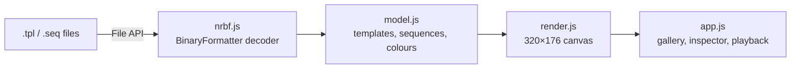

# DisplayLink Previewer

See what a Colorado Time Systems DisplayLink scoreboard template looks like without opening
DisplayLink on the timing PC.

## Problem

DisplayLink stores scoreboard layouts as `.tpl` templates and `.seq` sequences. The files are
binary, only DisplayLink can open them, and DisplayLink runs on the Windows timing computer.
Reviewing or sharing a meet's boards means sitting at that machine.

## Features

- Opens a whole template library (folder picker or drag and drop) and shows every board in a gallery
- Large preview with optional LED-dot rendering, zoom, and PNG download
- Overlay templates (transparent backgrounds) shown over a checker or black backdrop
- Item inspector: position, text, font, colour, and the live data field each item is bound to
  (for example `SCBD_SW_TM[3]`, lane 3's time)
- "Show data fields" swaps placeholder text for field codes
- Sequences play in order with their real durations; slides are matched to files in the loaded folder
- Load CTS `.scb` start lists (from Hy-Tek Meet Manager or SwimTopia Meet Maestro) to see real names,
  teams and event titles in the `MM_` fields; step through heats, or divers for diving events
- Runs entirely in the browser: files are decoded locally and never uploaded
- WCAG AAA colour contrast, keyboard navigation (← → Esc)

## Quick Start

Locally, with a library preloaded:

```sh
python3 serve.py ~/Documents/"DisplayLink Library"/Templates
```

Or open `web/index.html` directly and use **Open folder**.

With Docker:

```sh
docker compose up -d          # http://localhost:8080
PORT=9000 docker compose up -d  # pick another port
```

Or without Compose:

```sh
docker build -t displaylink-previewer . && docker run --rm -p 8080:80 displaylink-previewer
```

## Self-hosting

The container is a static nginx site: the previewer runs entirely in the visitor's browser, so
there is no backend, database or upload storage to look after.

- Put it behind any reverse proxy for TLS (Caddy, Traefik, nginx…) pointing at port 80 of the
  container, or at the published host port.
- To attach it to an existing Docker network instead of publishing a port, add a
  `docker-compose.override.yml` (git-ignored, picked up automatically by `docker compose`):

  ```yaml
  services:
    displaylink-previewer:
      ports: !reset []
      networks: [proxy]
  networks:
    proxy:
      external: true
  ```

- The image sets a strict Content-Security-Policy; the only third-party request is Google Fonts.
- To share a library (templates plus `.scb` start lists) with visitors, copy it to a folder on
  the host, index it, and mount it read-only at `/usr/share/nginx/library`. The page loads it on
  open, as with `serve.py`:

  ```sh
  python3 serve.py --write-index library      # writes library/index.json
  ```

  ```yaml
      volumes:
        - ./library:/usr/share/nginx/library:ro
  ```

- To require a password, mount a folder at `/etc/nginx/auth` holding an `htpasswd` file and an
  `auth.conf`. Do this whenever the library holds start lists (swimmers' names), and serve the
  site over HTTPS only:

  ```sh
  mkdir -p auth
  printf '%s:%s\n' "$USER_NAME" "$(openssl passwd -apr1)" > auth/htpasswd
  printf 'auth_basic "DisplayLink Previewer";\nauth_basic_user_file /etc/nginx/auth/htpasswd;\n' > auth/auth.conf
  ```

  ```yaml
      volumes:
        - ./auth:/etc/nginx/auth:ro
  ```

  `/healthz` stays open for health checks. `library/` and `auth/` are git-ignored.

## Architecture



| Path | Purpose |
|---|---|
| `web/nrbf.js` | MS-NRBF (.NET BinaryFormatter) decoder; also loads in Node |
| `web/model.js` | Decoded objects → templates / sequences / library indexes; .NET `KnownColor` table |
| `web/render.js` | Draws a template at panel resolution; LED-dot upscaler |
| `web/scb.js` | CTS `.scb` start-list parser and `MM_` field substitution; also loads in Node |
| `web/app.js` | Gallery, detail view, inspector, sequence playback, start-list picker |
| `serve.py` | Local server (127.0.0.1 only) that can preload a library under `/library/` |
| `nrbf.py` | Python decoder: `python3 nrbf.py file.tpl` prints the file as JSON |
| `tools/parity.js` | Dumps files with the JS decoder for diffing against `nrbf.py` |
| `Dockerfile`, `docker/`, `docker-compose.yml` | Static nginx container |

## Details

### File format

- Files are .NET BinaryFormatter output from `Cts.DisplayLink.Graphics.Templates` 1.3.14.
- `Template`: `width`×`height` (320×176 for a 10 mm board), `Background` colour, optional
  `backgroundGraphic`, and `items` in paint order:
  - `TextTemplateItem`: static text, font, colours, alignment
  - `DataTextTemplateItem`: text bound to a live field via `SourceClass`, `Code` and `Index`
  - `GraphicTemplateItem`: an image embedded as PNG, plus its original path
  - `ShapeTemplateItem`: a filled/outlined rectangle
- Data text items keep their row height in `Height`; the inherited `height` is always 0.
- `GraphicSequence` (`.seq`): slides reference files by absolute Windows path; durations are
  .NET ticks (10,000,000 per second).
- Sequence lookup prefers exact paths (relative to the sequence folder for relative references),
  then the longest matching directory suffix when Windows library prefixes differ. A basename
  fallback is used only when unique; ambiguous matches are reported in the slide card.
- Playback honors finite loop counts and subsecond durations. Each slide's duration starts
  after rendering; the final slide remains visible when finite playback ends.
- `lib.cache` is DisplayLink's per-folder index (paths, dates, thumbnails for images and video).
- Both decoders require a supported serialization header, the declared root object and a
  complete `MessageEnd`. Premature EOF and missing references are errors. Stale bytes after
  the first complete stream are still ignored for compatibility with existing `lib.cache` files.

### Start lists (.scb)

- Hy-Tek Meet Manager and SwimTopia Meet Maestro export one CTS `.scb` file per event. Line 1
  is `#<event> <title>`; then 10 lines per heat, one per lane: a 20-character name, `--`, and
  the team. Relays put the relay name (`TEAM A`) in the name slot.
- Open them with **Open files** or drag them in alongside a library. A **Start list** bar
  appears in the detail view: pick an event, step through heats (↑ ↓), and optionally type a
  meet title for `MM_SW_MT`.
- Fields filled: `MM_SW_ET` (event title), `MM_SW_NM[lane]` and `MM_SW_AF[lane]` (name and
  team). Events whose title contains `DIVING` fill `MM_DV_ET`, `MM_DV_NM` and `MM_DV_AF`, one
  diver at a time in start order.
- Start lists hold swimmers' names. They are read in the browser, `*.scb` is git-ignored, and
  they are only served when you place them in a library folder yourself (`serve.py`, or a
  password-protected container; see Self-hosting).

### Rendering limits

- The `DisplayLink NxM` LED fonts aren't available, so a bold sans at M px stands in, thresholded
  to whole pixels. Line widths match the originals closely; glyph shapes don't exactly.
- Fonts that aren't installed (such as Knockout) fall back to similar fonts, squeezed to the
  `ActualWidth` DisplayLink recorded so text keeps its real footprint.
- Scrolling text is shown static; data fields show their design-time placeholder text unless a
  start list fills the `MM_` fields.
- Start-list text is shown as written in the `.scb` file. DisplayLink's per-field `DataFormat`
  (for example "Format 3" on names) may reformat it on the board; that is not modelled.
- Text and outlines are clipped to their item bounds; the inspector uses those same bounds.

### Regression tests

No additional dependencies are required:

```sh
node --test tests/*.test.js
python3 -m unittest discover -s tests -p 'test_*.py'
```

### Performance

A 60-template library decodes and renders its gallery in about a second on a laptop; each
template is a few KB to a few hundred KB.

## License

Apache 2.0. Not affiliated with Colorado Time Systems; DisplayLink is their product.
